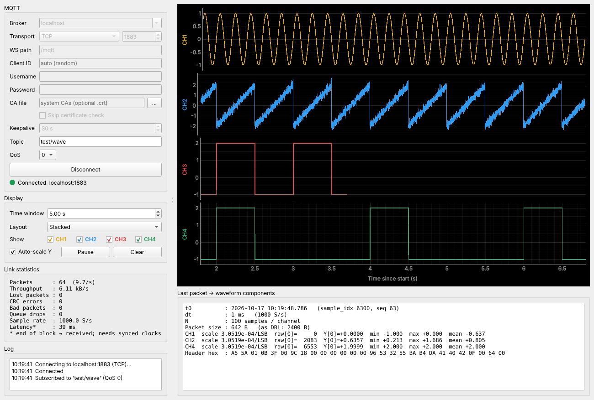

# NX Logger

MQTT data logger for ESP32-S3 DAQ nodes: live waveforms from multiple topics, 4-level
alarms with notifications, recording to CSV / TDMS / raw packets, and custom views -
in the style of NI FlexLogger and Yokogawa GA10. Data travels as a compact binary
waveform format (int16 + per-channel scale, see [docs/packet-format.md](docs/packet-format.md)).



## Install and run

```bash
pip install -e ".[dev]"
python -m nxlogger            # the logger
python -m nxlogger.sim        # signal generator (stand-in for the ESP32): Connect, then Start
```

Both default to `broker.emqx.io`, TCP 1883, topic `spexth/daq/demo/wave`.
The broker is public: anyone can read the topic, so use your own topic name and
never send real or sensitive data there. Defaults are in `config.ini`
([docs/config.md](docs/config.md)).

Transports: TCP 1883, TLS 8883, WebSocket 8083, Secure WebSocket 8084 (path `/mqtt`).
For TLS you can leave CA file empty (system CAs) or load the broker's CA file.
MQTT over QUIC is not supported by paho-mqtt.

## Features

- **Project** (`.sxl`, JSON; MQDAQ `.mqdaq` files open too): topics, channels with
  scaling (linear, two-point, safe formulas), logging profiles, alarms, views.
- **Screen and views:** live plots (stack / grid, box zoom), free-form views with
  plot, text, numeric, statistics and alarm tiles.
- **Alarms:** 4 levels per channel (H, L, difference, rate of change, data loss) with
  hysteresis and on-delay, ACK and latch, alarm log, notifications (popup, REST webhook,
  MQTT publish).
- **Recording:** each run makes a session folder with `project.json` and one file per
  profile - Signal (CSV / TDMS / lossless `.wpk`) or Statistic (one row per interval).
- **Diagnostics:** lost packets, CRC errors, malformed packets and publisher restarts.

## Development

```
src/nxlogger/
  core/       no Qt: wavepacket, project, ring, recording, alarm_rules, channel_math, view_model
  comms/      MQTT client
  ui/         main_window, app, icons, dialogs/, widgets/, theme/
  sim/        publisher
  resources/  config.default.ini, icons (app + Lucide UI icons)
tests/        pytest (no broker needed)
packaging/    PyInstaller spec, Inno Setup script, build.ps1
docs/         packet format, config keys, screenshots
tools/        mqtt_check.py - broker connectivity check
```

```bash
python -m pytest -q                 # tests
.\packaging\build.ps1               # EXE + installer (Windows, needs Inno Setup 6 for the installer)
```

Working with Claude Code: `CLAUDE.md` and the `nxlogger-dev` skill in `.claude/skills/`.
The last flat-file MQDAQ version is git tag `v6-mqdaq`.
