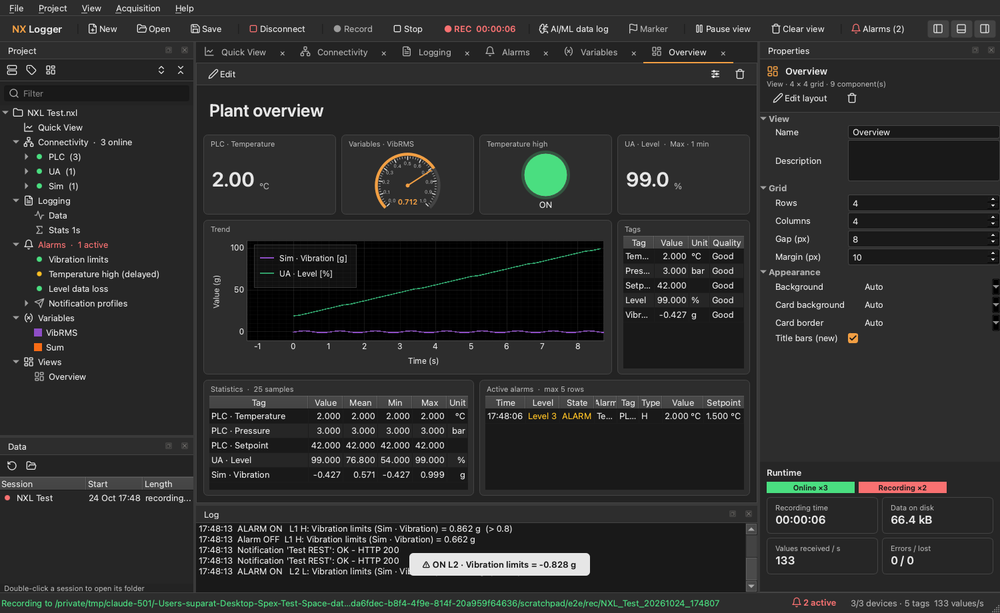

# NX Logger

Data logger for numbers from industrial devices - in the style of Yokogawa GA10, with the
connectivity of a SCADA (Genesis64, FUXA):

- **Connectivity:** devices and tags from **Modbus TCP**, **Modbus RTU**, **MQTT**
  (JSON / plain values, or ESP32 waveform packets), **OPC UA** (client with address-space
  browser) and a built-in **simulator**. Tags in groups, live value / quality / time,
  write to RW tags, tag list import / export (CSV). OPC DA is planned.
- **Views:** free-form screens with a snap grid - drag components to move them, the corner
  grip to resize: header, trend, FFT / spectrogram / histogram, number, gauge, LED, tag table,
  statistics table, alarm table.
- **Statistics** over windows the app buffers itself: seconds, minutes, hours or a number
  of samples, moving or block (mean of each full minute ...).
- **Workbench editing (Genesis64 style):** double-click a device, tag, group, alarm,
  variable or logging profile in the Project tree and it opens as a closable editor tab
  (Full Path header, collapsible sections, Apply / Refresh / Close / New... / Apply & Close /
  Apply & New...). Pop-ups are only used for actions inside a tab. The **Tags** branch of
  the tree manages tags and groups; the **Properties panel** edits the selection quickly.
- **Alarms:** 4 levels per tag (H, L, difference, rate of change, data loss) with
  hysteresis, on-delay, ACK / latch, alarm log, notifications (popup, REST, MQTT).
- **Recording:** session folders with CSV (and raw `.wpk` for waveforms) plus a
  `project.json` index for the NX Viewer ([docs/recording-format.md](docs/recording-format.md));
  statistic profiles (one row per interval); 24/7 AI/ML data log.



## Install and run

```bash
pip install -e ".[dev]"
python -m nxlogger            # the logger
python -m nxlogger.sim        # ESP32 waveform simulator over MQTT (Connect, then Start)
```

A new project opens with a **Simulator** device and an *Overview* view: press
**Connect** (Ctrl+K) to see live data. Add your own devices in **Connectivity**
(Add device ▾) - see [docs/connectivity.md](docs/connectivity.md) for the connectors,
address formats and the tag list CSV. Projects are `.nxl` (JSON); `.sxl` and `.mqdaq`
files open and are converted.

MQTT defaults to the public `broker.emqx.io` (anyone can read it - use your own topic
names and never send real data there). Defaults are in `config.ini`
([docs/config.md](docs/config.md)).

## Development

```
src/nxlogger/
  core/       no Qt: tags (devices, tags, connector schemas), project, view_model,
              stat_buffer, ring, recording, ml_log, alarm_rules, channel_math, analysis,
              variables, wavepacket
  comms/      drivers/ (sim, modbus, mqtt, opcua - one thread per device), manager.py,
              mqtt_client.py (Qt wrapper, used by the simulator)
  ui/         main_window, app, icons, dialogs/, widgets/ (connectivity, property_grid,
              properties, views, alarm_panel, variables_panel), theme/
  sim/        waveform publisher
  resources/  config.default.ini, icons (app + Lucide UI icons)
tests/        pytest - no broker or hardware (Modbus / OPC UA tests start local servers)
packaging/    PyInstaller spec, Inno Setup script, build.ps1
docs/         connectivity, recording format, packet format, config keys, screenshots
tools/        mqtt_check.py - broker connectivity check
```

```bash
python -m pytest -q                 # tests
python -m pyflakes src tests        # lint
.\packaging\build.ps1               # EXE + installer (Windows, needs Inno Setup 6 for the installer)
```

Working with Claude Code: `CLAUDE.md` and the `nxlogger-dev` skill in `.claude/skills/`.
Earlier versions: SX Logger / MQDAQ (MQTT waveform logger); the last flat-file MQDAQ
version is git tag `v6-mqdaq`.
